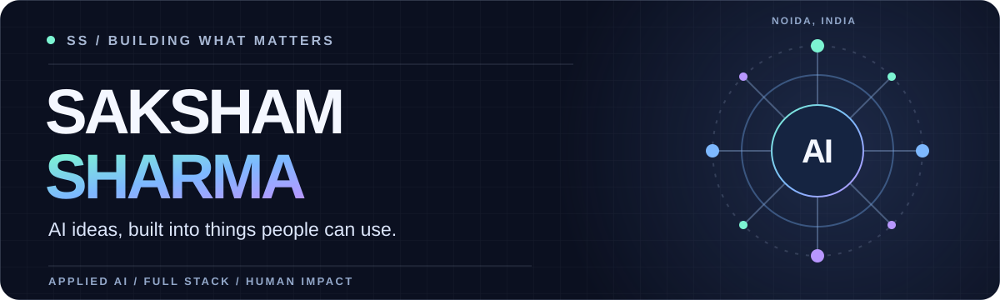
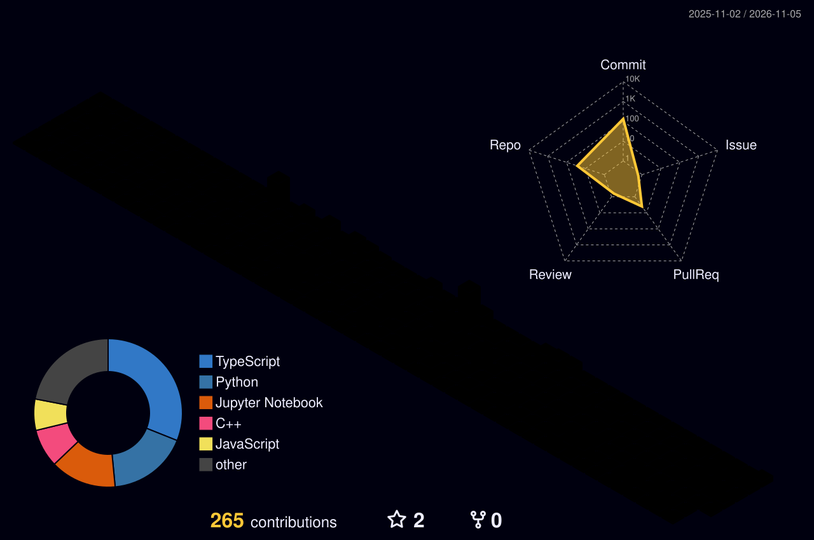

  

  
  
  

<strong>Builder of useful AI products</strong> · Noida, India · Open to work &amp; collaborations

---

### Hey, I'm Saksham 👋

I take ideas from **model to interface to real-world use**. I care most about AI that makes something easier, safer, or more accessible for the person on the other side of the screen.

My work moves between applied machine learning, agent systems, and full-stack product development. Here's a little of what I've been building.

### ✦ Selected builds

<table>
  <tr>
    <td width="50%" valign="top">
      <h3>🗣️ <a href="https://github.com/Dumbsham/Saksham">Saksham</a></h3>
      
A voice-first, multilingual platform helping women in India explore skills, learning paths, and income opportunities.

      
<code>AI guidance</code> <code>TypeScript</code> <code>Social impact</code>

      <a href="https://github.com/Dumbsham/Saksham">Source →</a> · <a href="https://www.saksham-ai.online">Live demo ↗</a>
    </td>
    <td width="50%" valign="top">
      <h3>🏏 <a href="https://github.com/Dumbsham/FieldUp">FieldUp</a></h3>
      
AI-powered match strategy, player insights, and injury-risk analysis for grassroots cricket teams.

      
<code>Next.js</code> <code>FastAPI</code> <code>Gemini</code>

      <a href="https://github.com/Dumbsham/FieldUp">Explore the project →</a>
    </td>
  </tr>
  <tr>
    <td width="50%" valign="top">
      <h3>🛡️ <a href="https://github.com/Dumbsham/Razor">Razor</a></h3>
      
Transaction fraud detection using rolling-window spike analysis, cost-sensitive ML, and synthetic fraud bursts.

      
<code>Python</code> <code>LightGBM</code> <code>Isolation Forest</code>

      <a href="https://github.com/Dumbsham/Razor">Explore the project →</a>
    </td>
    <td width="50%" valign="top">
      <h3>🔬 <a href="https://github.com/Dumbsham/Research_Agent">ResearchMind</a></h3>
      
A four-stage agent pipeline that searches, reads, writes, and critiques sourced research reports.

      
<code>Python</code> <code>LangChain</code> <code>Streamlit</code>

      <a href="https://github.com/Dumbsham/Research_Agent">Explore the project →</a>
    </td>
  </tr>
</table>

**On the workbench:** [FinAgent](https://github.com/Dumbsham/FinAgent), an in-development multi-agent research platform for Indian listed companies and market filings.

### ⚙️ The tools I reach for

| Area | Stack |
| :-- | :-- |
| **AI & data** | Python · PyTorch · TensorFlow · scikit-learn · Pandas · LangChain |
| **Products** | TypeScript · JavaScript · React · Next.js · Tailwind CSS |
| **Systems** | FastAPI · Node.js · MongoDB · Docker · Git · AWS |

  
<strong>More experiments, models, and apps</strong>

   
  
<a href="https://github.com/Dumbsham/SnapFeed">SnapFeed</a> · <a href="https://github.com/Dumbsham/Insurance-Premium-Predictor-Project">Insurance Premium Predictor</a> · <a href="https://github.com/Dumbsham/Car-Price-Prediction-Project">Car Price Prediction</a> · <a href="https://github.com/Dumbsham/Heart-Disease-Prediction-Project">Heart Disease Prediction</a> · <a href="https://github.com/Dumbsham?tab=repositories">All repositories →</a>

### 🌈 The build trail

  

---

  <strong>Have a problem worth solving?</strong> 
  I'm up for thoughtful collaborations, ambitious products, and conversations about AI with a purpose.  
  <a href="mailto:sakshamnoida37@gmail.com">Email me</a> · <a href="https://www.linkedin.com/in/saksham14sharma/">Find me on LinkedIn</a> · <a href="https://devsaksham.vercel.app">See my portfolio</a>

